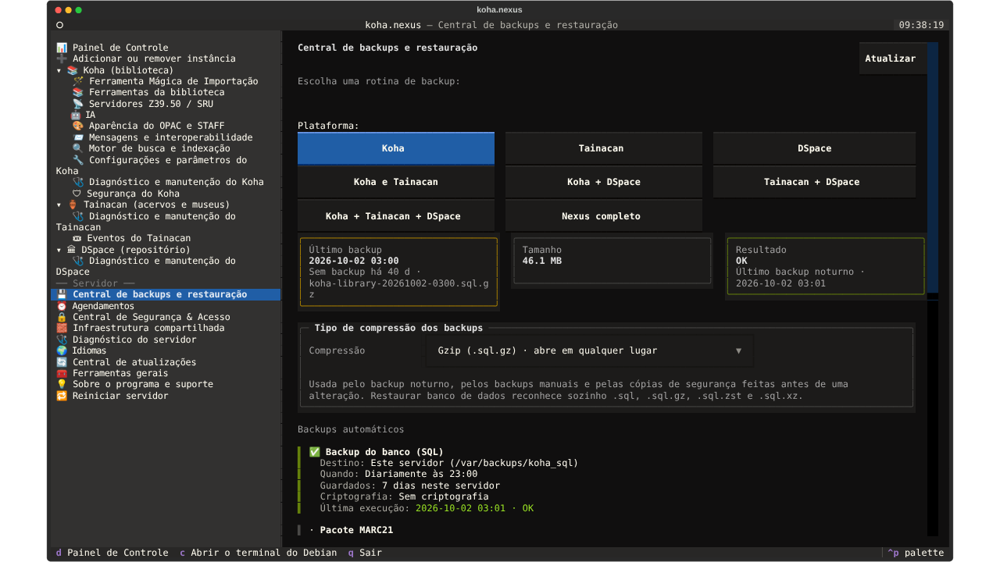
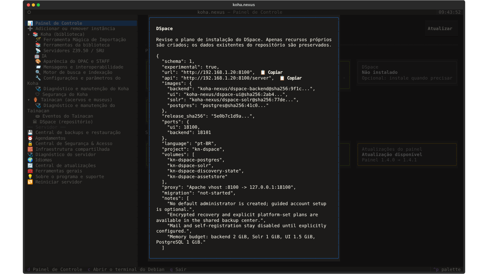
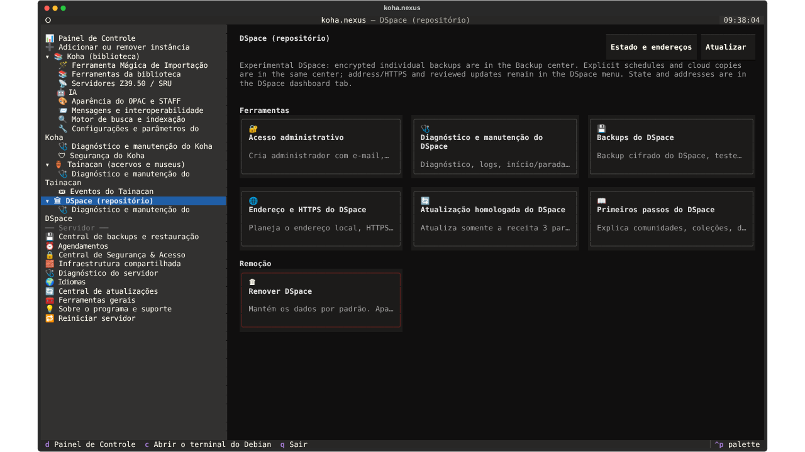
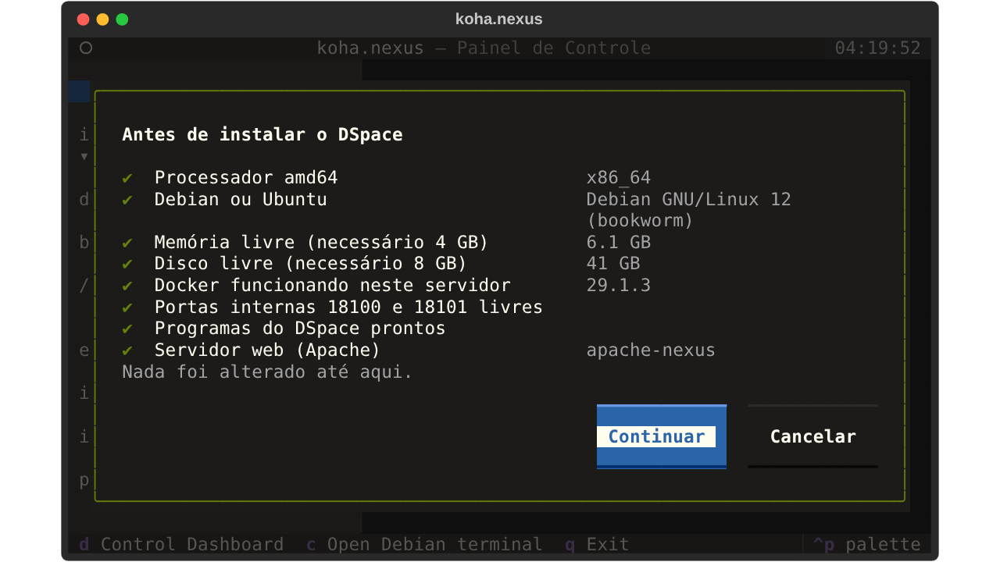
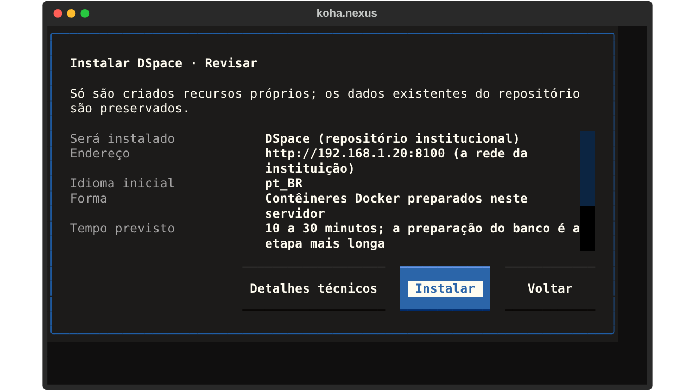
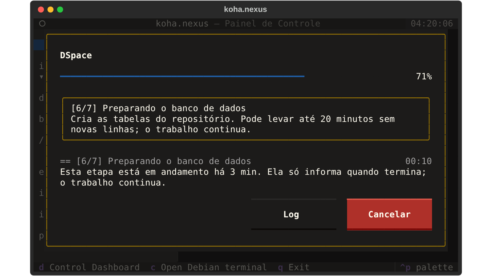
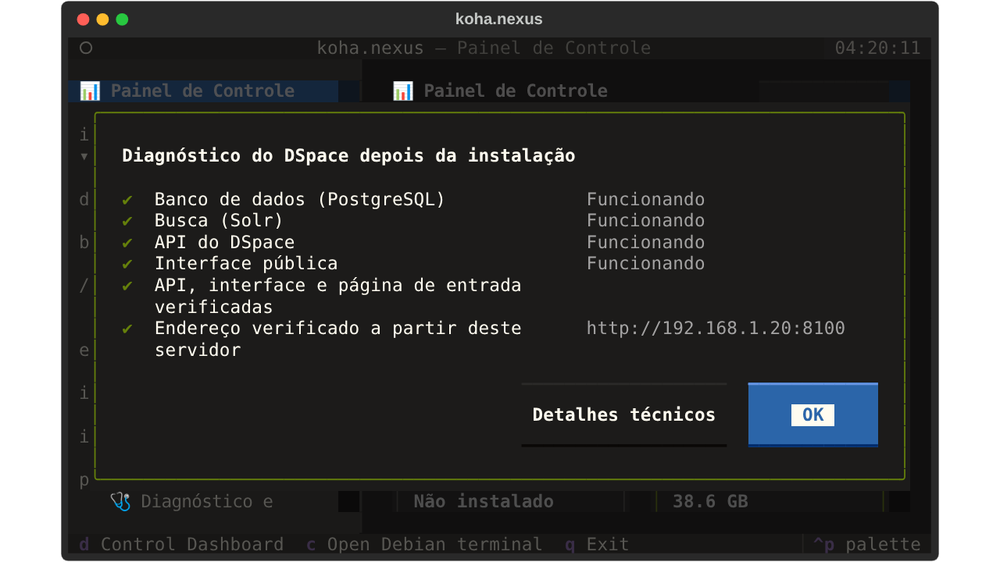

# Estudo de usabilidade, organização e confiabilidade do painel

Estudo pedido por Paulo em 11/11/2026. **Primeira entrega: somente investigação
e planejamento.** Nenhuma tela, rotina, contrato ou instalação foi alterada.
A implementação começa depois da aprovação, em PRs separados.

Base inspecionada: `main` em `e2fc5db` (painel 1.5.194), que já contém o
#365 (backup completo do Nexus) e o #366 (`fix/dspace-full-recovery-timeout`,
commit `f942735`). Ver a seção 1.

Como as telas foram examinadas: o painel real (Textual 8.2.8) foi aberto em
**modo demonstração** (`--demo`, instalador simulado), em português, nos
tamanhos 80×24 e 160×48, com Koha, Tainacan e DSpace marcados como instalados.
Os diálogos da instalação do DSpace foram montados com os **mesmos
componentes e os mesmos textos** da rotina (`routines/dspace.py`), porque o
modo demonstração interrompe essa instalação na primeira pergunta. As capturas
estão em [`capturas/`](capturas/). Elas mostram a interface; **não são testes
de aplicação real**. Nada foi executado no servidor de Paulo.

Legenda de classificação usada em todo o documento:

| Marca | Significado |
|---|---|
| ✅ Funciona | Já funciona, com evidência no código, nos testes ou na CI |
| 🔧 Melhorar | Existe, mas precisa de melhoria |
| 🐞 Defeito | Defeito reproduzido aqui |
| ⛔ Limitação | Limitação técnica atual (exige mudança de arquitetura) |
| ➕ Falta | Ainda não implementado |
| 🖥 Servidor | Depende de informação ou teste no servidor de Paulo |

---

## Sumário

1. [Estado real do repositório e da CI](#1-estado-real-do-repositório-e-da-ci)
2. [Diagnóstico: os problemas principais](#2-diagnóstico-os-problemas-principais)
3. [Tabela de problemas e soluções](#3-tabela-de-problemas-e-soluções)
4. [Classificação dos requisitos pedidos](#4-classificação-dos-requisitos-pedidos)
5. [Inventário e critério de organização](#5-inventário-e-critério-de-organização)
6. [Árvore proposta da navegação](#6-árvore-proposta-da-navegação)
7. [Esboços das telas, antes e depois](#7-esboços-das-telas-antes-e-depois)
8. [Padrão compartilhado: instalação, progresso, conclusão, diagnóstico e erro](#8-padrão-compartilhado)
9. [Uma ou várias instâncias: recomendação](#9-uma-ou-várias-instâncias-recomendação)
10. [Modalidades de instalação, portas e domínios](#10-modalidades-de-instalação-portas-e-domínios)
11. [Indicador do Windows](#11-indicador-do-windows)
12. [Preservação e migração das instalações existentes](#12-preservação-e-migração)
13. [Sequência de PRs](#13-sequência-de-prs)
14. [Plano de validação](#14-plano-de-validação)
15. [Decisões e testes que dependem de Paulo](#15-decisões-e-testes-que-dependem-de-paulo)
16. [Aprovação e acréscimos (11/11/2026)](#16-aprovação-e-acréscimos-11112026)
17. [Revisão do plano: navegação, idiomas, remoção do Koha e endereços](#17-revisão-do-plano-navegação-idiomas-remoção-do-koha-e-endereços)

---

## 1. Estado real do repositório e da CI

| Item | Situação verificada |
|---|---|
| Backup completo do Nexus (#365) | **Na main** (`945ab13`). Aba “Nexus completo” na Central de backups, `--task nexus-full`, pacote `.nexus` cifrado. |
| Correção da CI do DSpace (`fix/dspace-full-recovery-timeout`, `f942735`) | **Na main** pelo #366 (`e2fc5db`, 10/11/2026 18:46). |
| Execução citada [42896280128](https://github.com/PauloFBaldiFH/koha.nexus/actions/runs/42896280128) | Concluída com sucesso, na branch, commit `f942735`. |
| CI do merge na main ([42908335791](https://github.com/PauloFBaldiFH/koha.nexus/actions/runs/42908335791)) | Verde. As duas suítes reais obrigatórias passaram separadas: `integration (lifecycle)` em ~30 min e `integration (backup-operations)` em ~45 min; `upgrade (3)` e `upgrade (4)` em ~19–20 min. |
| Outras CIs da main | `Platforms panel`, `Tainacan end to end`, `nexus_core`, `windows-tools`, `Magic Import`, `Website languages` verdes no merge do #365. O #366 só disparou `DSpace image foundation` e `Magic Import` (filtros de caminho). |
| PRs abertos | Quatro antigos (#32, #201, #207, #225), sem relação com este estudo. |
| `docs/plano-instancias.pt-BR.md` | **Não existe no repositório.** A continuidade do #365 diz que era um arquivo local do ambiente anterior. Existe, sim, `docs/plano-recuperacao-e-instancias.pt-BR.md` (08/11), que o cita e o substitui. Reavaliei este último contra o código atual (seção 9). |

O que daquele plano de 08/11 já chegou à main (conferido no código, não só nos
documentos): leitura de status tolerante e com prazo (#359); fim da abertura
automática dos assistentes de domínio e nuvem depois de instalar (#359,
`setup.maybe_start` não é mais chamado por ninguém); compactação dos backups
do DSpace e do Tainacan (#359, #364); controles editáveis de agenda (#360);
correção do endereço do DSpace e checagens web (#361, #362); idiomas do DSpace
(#363); backup completo (#365). **Continua pendente**: registro de instâncias
ligado ao instalador, recursos por instância, navegação por instância,
remoção nativa do Koha e broker para várias instâncias.

---

## 2. Diagnóstico: os problemas principais

Em ordem de impacto no uso diário.

### 2.1. Central de backups: as ações ficam fora da tela e aparecem tarde 🐞

**Sintoma.** Ao abrir a Central, os botões de “fazer backup”, “restaurar”,
“testar” etc. não aparecem; depois de alguns segundos surgem muito abaixo, e ao
trocar de filtro os cartões do filtro anterior continuam na tela até a leitura
terminar.

**Reprodução** (modo demonstração, script
[`medir_backups.py`](medir_backups.py)):

```text
80x24  koha      antes= 0 depois= 8 primeiro_cartao_linha= 85 altura=117
80x24  both      antes= 4 depois= 4 primeiro_cartao_linha= 87 altura=101
160x48 koha      antes= 0 depois= 8 primeiro_cartao_linha= 65 altura= 87
160x48 tainacan  antes= 7 depois=10 primeiro_cartao_linha= 57 altura= 87
```

Em 160×48 a área visível tem ~44 linhas: o primeiro botão do Koha está na
linha 65. Em 80×24 (~20 linhas visíveis) está na linha 85: é preciso rolar
quatro telas para chegar a ele.



**Causa confirmada** (`panel/kei_panel/views/backups.py` e `views/platform.py`):

1. `BackupCenterView.heading()` desenha, **antes** dos cartões de ação, o
   seletor com até 8 combinações de filtro (3 linhas de botões largos), os
   indicadores, a caixa de compactação, dois parágrafos de explicação e a lista
   inteira de “Backups automáticos” (5–6 linhas por agenda). Os cartões são
   desenhados pela classe-mãe depois de tudo isso.
2. `PlatformSectionView.on_mount()` esconde todos os cartões até a leitura
   terminar (“nothing is offered before the state is read”). A leitura faz
   chamadas sequenciais ao instalador: 5 no filtro Koha (`status` duas vezes,
   `info`, `cloud-status`, `cloud-list`) e 10 no filtro “Koha e Tainacan”, que
   lê a nuvem duas vezes.
3. `_load()` só chama `show()` no fim; se qualquer leitura intermediária lançar
   uma exceção não tratada, `show()` não roda e os cartões ficam escondidos até
   “Atualizar” (é o “algumas opções só aparecem depois de atualizar”).
4. `_draw_plans()` remove e recria a lista de agendas, o que empurra os
   cartões para baixo de novo quando a lista chega.

**Proposta.** Ações sempre visíveis logo abaixo do resumo, desenhadas desde a
abertura, com estado “aguardando leitura” e motivo quando ainda não puderem ser
usadas; indicadores preenchidos no lugar, sem reconstruir; agendas resumidas em
uma linha cada, com link para a Central de agendamentos; filtro em um seletor
compacto. Esboço na seção 7.5.

### 2.2. Instalação do DSpace: termos técnicos, JSON e progresso sem base ❌🔧

Fluxo atual (`routines/dspace.py::install`):

1. Pergunta sobre **preparar “imagens experimentais”**, explicando que compila
   “backend, interface e Solr” e instala Git (captura 14).
2. Se for WSL, pergunta “Este computador (localhost)” ou “**Outros computadores
   ou um domínio institucional**”, que mistura rede local e publicação (15a).
3. Pede o endereço com um exemplo de IP (15b).
4. Mostra o **plano como JSON bruto**: `schema`, `experimental: true`, imagens
   com digest, `release_sha256`, portas internas 18100/18101, volumes, projeto
   Compose, proxy, migração e quatro notas em inglês (16).
5. Executa com o carregador genérico. O runtime só imprime linhas soltas como
   `DSpace: images`, `DSpace: network`, `DSpace: Checking DSpace REST API`; o
   carregador mostra a última linha, em inglês, sem barra de avanço (17b). Em
   esperas longas a tela diz “Iniciando operação…” e “Sem nova saída há N
   segundos” (17a).
6. Conclusão: **uma frase e `…/login`** (18).



Causas no código:

- `platforms/dspace/runtime.py::plan()` devolve o contrato técnico, e a rotina
  do painel o imprime com `json.dumps(...)` em vez de resumi-lo.
- O progresso vem de `Runtime.mark(phase=…)` → `progress(phase)` →
  `print('DSpace: ' + phase)`. São nomes internos em inglês, sem número de
  etapa nem total. `bridge.TaskOutcome.feed` só calcula porcentagem a partir de
  `@@step`/`@@done` com `total_steps`, que o DSpace não emite.
- `runtime.command()` **nunca repassa a saída** dos subprocessos (“pode conter
  configuração/credenciais”). Por isso a caixa de log fica quase vazia durante
  `compose up`, migração e as esperas de até 600 s (`wait('DSpace REST API',
  …, 600)`). Não é bufferização nem captura errada: é a política de não
  imprimir, sem mensagem de atividade no lugar.
- A compilação das imagens (`tools/dspace_bootstrap.py`) já emite
  `Building experimental DSpace image: backend|ui|solr` e
  `Checking experimental DSpace image: …`: há base real para “etapa 2 de 3 da
  preparação”, mas não para porcentagem dentro de uma compilação.
- A conclusão (`MessageScreen` com a frase fixa) não consulta se existe
  administrador, não mostra o endereço público e o administrativo separados,
  nem oferece Abrir.

As mesmas apresentações em JSON aparecem em **Diagnóstico do DSpace**,
**Reparar acesso web**, **Testar recuperação** e **Restaurar** (o resultado
final é um `json.dumps` do retorno). “Criar backup” termina mostrando só o
caminho do arquivo.

### 2.3. “Experimental” repetido e textos em inglês no meio do português 🔧

- “Experimental” aparece na página inicial do DSpace (`platforms.dspace_problem`,
  modos `absent` e `installed`), em dois cartões do Painel de Controle
  (`dspace.py`: “DSpace experimental” em cada endereço e “Experimental;
  apenas amd64” na versão), no diálogo de preparação e no JSON do plano.
- O texto da página inicial do DSpace instalado **não tem tradução** e
  aparece em inglês na tela em português (captura 03).
- 23 textos `t()` das telas tocadas por este estudo não estão no `lang/pt.cache`
  (14 em `routines/dspace.py`, 7 em `views/backups.py`, 2 em
  `views/dashboard.py`), além das notas do plano, das fases do runtime e dos
  valores crus como `ready`, `running`, `not-started`.
- Na Central de backups o título diz “Escolha uma rotina de backup:” acima de um
  seletor que se chama “Plataforma:”. Há três textos diferentes para
  compactação (“Tipo de compressão dos backups”, “Compressão”, “Compactação”).

A palavra “experimental” não deve sumir sem substituto: hoje ela carrega duas
informações reais que precisam de lugar próprio: “só amd64” e “imagens
compiladas a partir de uma receita fixada, sem imagem oficial publicada”.
Proposta: mover para **Requisitos e limitações** (antes de instalar) e para
**Detalhes técnicos/Diagnóstico**, sem chamar de estável ou homologado.

### 2.4. Navegação: cada sistema segue uma regra diferente 🔧

| Sistema | Cartões na página do sistema | Itens abaixo dele na lateral |
|---|---|---|
| Koha | 14 (instalado, sem falha) | 10 |
| Tainacan | 6 | 2 |
| DSpace | 7 | **1** (Diagnóstico e manutenção) |



Além disso:

- “Backups do DSpace” e “Backups do Tainacan” são cartões que abrem a Central
  filtrada; “Agendamentos do Koha” idem; mas não há o mesmo para DSpace e
  Tainacan, cujas agendas ficam só na Central de agendamentos.
- Endereços estão espalhados: “Endereço do Tainacan” (grupo Tainacan),
  “Endereço e HTTPS do DSpace” (grupo DSpace), “Cloudflare Tunnel” e
  “Certificado SSL” (Central de Segurança, só Koha), “Firewall da equipe
  (porta 8080)” (Segurança do Koha).
- Diagnóstico: “Status detalhado” (página do Koha e Diagnóstico do servidor),
  “Verificação completa” (página do Koha e Diagnóstico do Koha), “Diagnóstico
  do Tainacan” (página e Diagnóstico e manutenção), “Diagnóstico do DSpace”
  (página e Diagnóstico e manutenção). As duplicações são intencionais (zona de
  recuperação), mas os nomes mudam.
- “Adicionar ou remover instância” é uma seção da lateral com dois cartões, e
  o termo “instância” aparece para quem ainda não sabe o que é.
- Em 80×24 os rótulos longos quebram em duas linhas na lateral
  (“Configurações e parâmetros do / Koha”, “Diagnóstico e manutenção do /
  Tainacan”), e a lateral passa de 30 linhas com os três sistemas.

### 2.5. Agendamentos: dia da semana mostra “0” 🐞

Na Central de agendamentos, uma agenda semanal mostra o dia como **“0”**, não
“Domingo” (captura 10). Verificado no modo demonstração: as opções do seletor
já são os nomes dos dias, mas o texto exibido continua o número. **Causa
provável**: `views/schedules.py::_fields()` cria o `Select` com números,
depois troca as opções e atribui o **mesmo** valor; o Textual não redesenha o
rótulo quando o valor não muda. Correção pequena: criar o seletor já com os
rótulos certos para a frequência inicial.

Outros pontos (🔧): o interruptor não tem rótulo (“Ativo”), cada agenda ocupa
6–7 linhas, o destino do backup não aparece na agenda (só na Central de
backups) e não há filtro por sistema a partir da página do sistema para DSpace
e Tainacan.

### 2.6. “Adicionar instância” esconde o sistema já instalado ⛔ + 🔧

`routines/instances.py::add` lista só os sistemas **não** instalados. Com os
três instalados, mostra “Todos os espaços de aplicativo suportados estão
instalados”. A causa não é um botão faltando: os drivers são de uma instalação
por tipo (seção 9). A correção imediata é de linguagem: mostrar os três, com
“Instalado: Biblioteca Central · abrir” e uma explicação curta.

### 2.7. Indicador do Windows só fala do Koha 🐞

`windows/KohaEasy.Core.psm1`: `Resolve-KohaState` devolve `not_installed`
quando o `--status-json` diz `state: not_installed`, e esse campo vem de
`kei_overall_state`, que só olha o Koha. `Get-KohaStateText` então mostra
**“O Koha não está instalado”** mesmo com Tainacan ou DSpace funcionando.
Iniciar, parar, reindexar e “abrir OPAC/Staff” também são do Koha. A
consulta (`--status-json` completo a cada 60 s) já traz `platforms[]` com
Tainacan e DSpace, então o dado existe; falta usá-lo.

### 2.8. Endereço durante a instalação 🔧

- Tainacan pergunta **antes** de instalar “Onde o acervo vai responder?”, com
  “domínio próprio” e “endereço gratuito koha.nexus”. Escolher o gratuito abre o
  assistente logo depois da instalação (`routines/platforms.py::tainacan_install`).
- DSpace no WSL pergunta “Este computador” ou “Outros computadores ou um
  domínio institucional”; fora do WSL pede o endereço completo.
- Koha não pergunta nada (usa 80/8080).

A instalação não abre mais sozinha o assistente de nuvem e backup (✅ desde o
#359), mas a escolha de endereço ainda mistura “rede local” com “internet”.

### 2.9. Backup completo: o nome promete mais do que o arquivo faz sozinho 🔧

O código e `docs/backups/nexus-completo.pt-BR.md` são precisos, mas a tela diz
apenas “Restaura em aplicativos compatíveis preparados”. A pessoa não vê, no
momento de decidir, a diferença entre o que volta sozinho, o que fica guardado
para revisão e o que precisa existir antes (seção 7.6).

---

## 3. Tabela de problemas e soluções

Esforço: **P** (até 1 dia), **M** (2–4 dias), **G** (1–2 semanas),
**GG** (mais de 2 semanas). Risco: chance de afetar dados ou instalações.

| # | Problema | Situação | Impacto | Causa | Solução proposta | Prior. | Esforço | Risco | Teste de aceite |
|---|---|---|---|---|---|---|---|---|---|
| 1 | Ações da Central de backups longe e tardias | 🐞 | Alto, uso diário | Ordem do layout; cartões escondidos até ler tudo; lista recriada | Ações logo após o resumo, sempre desenhadas, desabilitadas com motivo; indicadores atualizados no lugar; agendas em uma linha | 1 | M | Baixo | 80×24 e 160×48: primeira ação visível sem rolar; nenhuma ação muda de posição durante a leitura; falha de uma leitura não esconde ações |
| 2 | Plano do DSpace em JSON | 🔧 | Alto na instalação | `json.dumps(plan)` na tela | Resumo em linguagem natural + “Ver detalhes técnicos” com o JSON original | 1 | P | Baixo | Tela sem chaves JSON; detalhes mostram o mesmo JSON de antes; contrato `--task dspace-panel plan` inalterado |
| 3 | Progresso do DSpace sem etapas | 🔧 | Alto | Runtime emite só `DSpace: fase` | Runtime emite `@@stage`/`@@step` com etapas nomeadas e total real; carregador comum mostra “Etapa 3 de 7” | 1 | M | Baixo | Instalação real na CI registra as etapas em ordem; nenhuma porcentagem durante compilação |
| 4 | Log “vazio” | 🔧 | Médio | Saída suprimida por segurança; log escondido; `wrap=False` | Linha de atividade por etapa (“aguardando a API responder, 2 min de até 10”); log com quebra; aviso fixo “ainda em andamento” | 1 | P | Baixo | Espera de 10 min sem saída mostra atividade e tempo; nenhuma senha no log |
| 5 | Conclusão incompleta | ➕ | Alto | `MessageScreen` com uma frase | Tela de conclusão comum (seção 8.3) com verificações, endereços, conta administrativa e próximo passo | 1 | M | Baixo | DSpace sem admin mostra “pendente” + Criar agora / Depois; com admin mostra a conta; nunca mostra senha |
| 6 | “Experimental” repetido | 🔧 | Médio | Textos fixos | Tirar das telas normais; manter em Requisitos e limitações, Detalhes técnicos e Diagnóstico | 1 | P | Nenhum | Busca por “experimental” só nos lugares definidos |
| 7 | Textos em inglês | 🐞 | Médio | 23 chaves sem tradução + valores crus | Completar `lang/pt.cache`; mapear fases e estados para textos | 1 | P | Nenhum | Teste que falha se uma chave `t()` das telas dos três sistemas faltar no pt |
| 8 | Dia da semana “0” | 🐞 | Médio | Select recebe o mesmo valor após trocar opções | Criar opções certas desde o início | 1 | P | Nenhum | Agenda semanal mostra “Domingo”; salvar grava `0` no cron |
| 9 | Lateral inconsistente | 🔧 | Médio | Cada grupo cresceu separado | Árvore da seção 6, mesmo critério para os três | 2 | M | Baixo | Teste de menu: cada sistema tem os mesmos 5 itens-padrão; nenhuma ação some |
| 10 | Endereços espalhados | 🔧 | Médio | Endereço de cada sistema nasceu em lugar diferente | Página “Endereços e acesso” por sistema + visão geral no servidor | 2 | M | Médio | Abrir não altera nada; cada sistema mostra local, rede e internet separados |
| 11 | Escolha “Outros computadores ou domínio” | 🔧 | Médio | Duas decisões numa pergunta | Sugestão automática; escolha simples “Neste computador / Na rede da instituição”; internet só depois | 2 | M | Médio | WSL: sugere localhost; Linux com IP local: sugere IP real; nenhum IP de exemplo gravado |
| 12 | Indicador do Windows só Koha | 🐞 | Alto no Windows | `state` do status é do Koha | Estado agregado (seção 11) com nome do sistema e motivo | 2 | M | Baixo | Só Tainacan instalado e saudável → verde “Museu Municipal funcionando” |
| 13 | Adicionar esconde instalado | 🔧/⛔ | Médio | Drivers de instância única | Mostrar instalados com nome e motivo; múltiplas só com driver (seção 9) | 2 | P | Nenhum | Com DSpace instalado, a lista mostra “DSpace · Repositório Institucional (instalado)” |
| 14 | Sem nome visível da instalação | ➕ | Médio | Registro de instâncias não ligado à interface | Nome de exibição no registro (`nexus_core/instances.py` já tem `rename`), usado em todas as telas | 2 | M | Baixo | Renomear não muda banco, diretório, volume nem URL |
| 15 | Backup completo pouco explicado | 🔧 | Médio | Texto curto | Tabela “volta sozinho / guardado para revisão / precisa estar pronto / não incluído” | 2 | P | Nenhum | Revisão de texto com Paulo |
| 16 | Diagnóstico/teste/restauração em JSON | 🔧 | Médio | `json.dumps` | Resumo + detalhes técnicos | 2 | P | Baixo | Mesmos dados acessíveis por “Ver detalhes técnicos” |
| 17 | Remoção do Koha | ➕ | Baixo/médio | Sem driver de remoção nativa | Fora deste ciclo; remoção existente de Tainacan/DSpace mantida | 4 | G | Alto | — |
| 18 | Koha por nome em vez de porta | ➕ | Médio | 80/8080 fixos | Opcional por domínio (seção 10.3) | 3 | G | Médio | Ver seção 10 |
| 19 | Várias instâncias reais | ⛔ | Baixo agora | Drivers singleton | Adiar; preparar contrato (seção 9) | 4 | GG | Alto | Duas instâncias reais do mesmo tipo |
| 20 | Koha em Docker | ⛔ | Baixo agora | Não existe driver | Estudo separado (seção 10.1) | 4 | GG | Alto | — |
| 21 | Agendas sem destino e muito altas | 🔧 | Baixo | Linha de 6–7 linhas | Linha compacta com destino e “Editar” | 2 | P | Baixo | 10 agendas cabem em 160×48 sem rolar |

---

## 4. Classificação dos requisitos pedidos

| Requisito (seção do pedido) | Classe | Evidência / observação |
|---|---|---|
| Instalação não abre assistentes de domínio/nuvem (6) | ✅ | `setup.maybe_start` sem chamadas desde o #359. Tainacan com “endereço gratuito” escolhido antes abre o assistente: 🔧 |
| Domínio/Cloudflare acessível depois (6) | ✅ | Cartões de endereço por sistema e Central de Segurança |
| DSpace sem “experimental” nas telas normais (4) | 🔧 | Seção 2.3 |
| Resumo natural do plano (4) | ➕ | Seção 8.1 |
| Verificação de requisitos do DSpace (5) | ✅ | `runtime.plan()`: amd64, Debian/Ubuntu, Docker Linux não rootless, 4 GiB livres, 8 GiB de disco, portas 18100/18101 |
| Preparação das imagens (5) | ✅ funciona / 🔧 apresentação | Compila localmente a partir de receita fixada (`build-inputs.zip` com SHA-256). Não há registro público de imagens |
| Retomar após interrupção (5) | ✅ | `state.json` com fase; “Instalar ou retomar”; migração interrompida exige confirmação própria |
| Reinício do computador/Docker (5) | ✅ CI / 🖥 WSL | `restart: unless-stopped`; job `integration (lifecycle)` reinicia o Docker. Reinício do WSL no Windows não é testado na CI |
| Atualização do DSpace (5) | ✅ | “Atualização revisada”, CI `upgrade (3)` e `(4)` |
| Progresso com etapas e tempo (7) | 🔧 | Tempo decorrido ✅; etapas ➕ |
| Log que parece vazio (7) | 🔧 | Causa: saída suprimida de propósito + log oculto por padrão (seção 2.2) |
| Cancelamento seguro (7) | ✅ | `cancellable=False` em instalação, restauração e backup; runtime trata SIGTERM preservando dados |
| Conclusão com conta administrativa (8) | ➕ | Criação de admin existe em “Acesso administrativo”; falta na conclusão |
| Não inventar credenciais (8) | ✅ | DSpace não cria admin padrão; senha só no ambiente da tarefa |
| Backups: layout e carregamento (9) | 🐞 | Seção 2.1 |
| Só compactações suportadas por motor (9) | ✅ | Koha gz/zst/xz/none; Tainacan, DSpace e Nexus gz/bz2/xz/none |
| Chave compartilhada parece do DSpace (9) | 🔧 | Menu: “Configurar a chave de backup do DSpace” e “Chave de recuperação compartilhada” convivem |
| Backup completo inclui várias instâncias do mesmo tipo (10) | ⛔ | Hoje há uma por tipo; pacote lista `applications` por tipo |
| Mapeamento origem→destino na restauração (10) | ⛔ | Restauração por tipo; não escolhe “a primeira” porque só há uma |
| Não reativar túneis/agendas da origem (10) | ✅ | Planos voltam desativados, túneis e cron ficam para revisão |
| Central de agendamentos com switch/hora (11) | ✅ + 🐞 | #360; defeito do dia da semana |
| Próxima execução e último resultado (11) | ✅ | `fill_times`, `_last_runs` |
| Tarefas manuais/de pacotes sem apropriação (11) | ✅ | Linhas somente leitura com “Editor original” |
| Nome personalizado (12) | ➕ | Registro tem `name` e `rename`, mas não é usado pela interface |
| Segundo DSpace (12) | ⛔ | Seção 9 |
| “Usar Docker” por padrão (13) | ⛔ para Koha | Só Tainacan e DSpace têm driver Docker; nenhum tem driver nativo |
| Koha com uma porta (14) | ➕ | Seção 10 |
| Indicador do Windows (15) | 🐞 | Seção 2.7 |
| Abrir tela não altera servidor (16) | ✅ | Testes `*_reads_only` existentes para DSpace, backups e agendas |
| Login do DSpace funcionando no servidor | 🖥 | #361/#362 corrigiram causas encontradas; não confirmado no servidor de Paulo |

---

## 5. Inventário e critério de organização

### 5.1. Inventário resumido

O inventário completo das 34 seções e ~150 entradas está em
`panel/kei_panel/menus.py` (pode ser listado com o script da seção 14.4). As
conclusões por grupo:

| Grupo | Itens | Pertence a | Observações |
|---|---|---|---|
| Painel de Controle | 4 abas (Geral, Koha, Tainacan, DSpace) | Servidor + sistema | Bom lugar para estado e endereços. Aba do DSpace mostra 9 cartões de serviço; “rodando” = contêiner, não aplicação |
| Adicionar ou remover instância | 2 | Servidor | Termo técnico; remoção duplica os cartões de remoção dos sistemas |
| Koha | 14 cartões + 10 na lateral | Sistema | Consistente; “Visualizar credenciais de primeiro acesso” e “Acesso administrativo” são vizinhos com propósito parecido |
| Ferramentas da biblioteca | 14 visíveis | Sistema (Koha) | Mistura catálogo, leitores, privacidade, plugins, logs e arquivos do servidor |
| Tainacan | 6 + 2 na lateral | Sistema | Endereço, backups e acesso só na página |
| DSpace | 7 + 1 na lateral | Sistema | Endereço, backups, atualização, primeiros passos só na página |
| Central de backups | 30 cartões filtrados por 8 combinações | Servidor | Combinações demais; ações abaixo do conteúdo |
| Agendamentos | Lista + 4 cartões “Outros editores” | Servidor | Funciona; densidade alta |
| Central de Segurança & Acesso | 5 | Servidor (2 só Koha) | Cloudflare e SSL são do Koha, mas estão no servidor |
| Infraestrutura compartilhada | Docker | Servidor | OK |
| Diagnóstico do servidor | 4 | Servidor | “Status detalhado do servidor & Koha” mistura |
| Idiomas | 5 (1 DSpace, 4 Koha) | Sistema | Deveria estar em cada sistema; a página geral só leva a eles |
| Atualizações | 2 | Servidor | OK |
| Ferramentas gerais | 5 | Servidor | OK |
| Sobre, Reiniciar | 2 | Servidor | OK |

### 5.2. Critério proposto para a lateral

Um item entra na lateral **somente** se cumprir uma destas condições:

1. **É um lugar, não uma ação**: abre uma tela com estado próprio (ex.:
   “Backups”, “Endereços e acesso”). Ações (“Iniciar”, “Criar
   administrador”) ficam dentro das páginas.
2. **É usado toda semana** por quem administra aquele sistema (ex.: Ferramenta
   Mágica de Importação, Servidores Z39.50 no Koha).
3. **É a porta de entrada de recuperação**: “Diagnóstico e manutenção” existe
   em todos os sistemas, mesmo quando há falha.

Cada sistema recebe **os mesmos cinco itens-padrão**, na mesma ordem e com o
mesmo nome, mais os seus específicos de uso frequente:

```text
<Nome da instalação> · <Sistema>
   Visão geral               (a página do sistema; o próprio título do grupo)
   Acesso administrativo
   Endereços e acesso
   Backups e agendamentos    (Central filtrada por este sistema)
   Diagnóstico e manutenção  (inclui atualizar, idiomas, logs, remover)
   ── específicos ──
```

Com isso a lateral passa a ter, por sistema, 5 itens fixos + no máximo 4
específicos (Koha) ou 1 (Tainacan: Eventos), e o DSpace deixa de ter um item
só. Idiomas, atualização e remoção deixam de ser seções soltas e vão para
“Diagnóstico e manutenção” (remoção sempre no fim, separada). A lateral cabe
em 80×24 com um grupo aberto por vez (os grupos já recolhem).

---

## 6. Árvore proposta da navegação

> **Revisada na seção 17** (11/11/2026): Aparência e IA continuam separadas,
> não há “Mais ferramentas do Koha”, Idiomas continua visível como central e a
> remoção do Koha entra como etapa própria (U11).

Uma instalação de cada sistema (recomendação da seção 9). Os nomes entre
aspas são exemplos de nomes escolhidos pela pessoa.

```text
📊 Painel de Controle                       d
➕ Adicionar sistema

📚 Biblioteca Central · Koha                k   (grupo; título = Visão geral)
   🔐 Acesso administrativo
   🌐 Endereços e acesso
   💾 Backups e agendamentos
   🩺 Diagnóstico e manutenção
   ── ferramentas ──
   🪄 Importação mágica                     i
   📚 Ferramentas da biblioteca             l
   📡 Servidores Z39.50 / SRU               z
   🎨 Aparência e IA                        o   (OPAC/Staff + IA, em abas)
   ⚙  Mais ferramentas do Koha              (Mensagens, Busca e indexação,
                                              Configurações, Segurança do Koha)

🏺 Museu Municipal · Tainacan               g
   🔐 Acesso administrativo
   🌐 Endereços e acesso
   💾 Backups e agendamentos
   🩺 Diagnóstico e manutenção
   ── ferramentas ──
   🎟 Eventos

🏛 Repositório Institucional · DSpace       j
   🔐 Acesso administrativo
   🌐 Endereços e acesso
   💾 Backups e agendamentos
   🩺 Diagnóstico e manutenção
   ── ferramentas ──
   📖 Primeiros passos

── Servidor ──
💾 Central de backups                       b
⏰ Central de agendamentos                  s
🌐 Endereços e publicação                   (visão de todos; túnel e certificados)
🔒 Segurança                                x   (firewall, VPN, fail2ban)
🧱 Infraestrutura compartilhada             p   (Docker, proxy web)
🩺 Diagnóstico do servidor
🔄 Atualizações
🧰 Ferramentas gerais
⚙  Preferências do painel                   (idioma do painel)
💡 Sobre e suporte
🔁 Reiniciar servidor
```

Sistema ausente: o grupo mostra só o título “Koha (biblioteca) · instalar” e
leva à página de apresentação (esboço 7.2). Não some da lateral, para que a
pessoa encontre o que pode instalar.

Mapa do que muda de lugar (nenhuma rotina é removida):

| Hoje | Proposta |
|---|---|
| Adicionar ou remover instância | “Adicionar sistema” (lateral); remoção em Diagnóstico e manutenção de cada sistema |
| Idiomas (seção do servidor) | Idioma do painel em Preferências; idiomas de cada sistema em Diagnóstico e manutenção do sistema |
| Endereço do Tainacan / Endereço e HTTPS do DSpace / Cloudflare / SSL / Firewall 8080 | “Endereços e acesso” de cada sistema; “Endereços e publicação” no servidor reúne túnel e certificados |
| Backups do X (cartão) | “Backups e agendamentos” do sistema = Central filtrada |
| Agendamentos do Koha | Idem |
| Aparência do OPAC e STAFF + IA | Uma entrada com abas (reduz 1 item da lateral do Koha) |
| Mensagens, Busca, Configurações, Segurança do Koha | “Mais ferramentas do Koha” (página com cartões) |
| Atualização revisada do DSpace | Diagnóstico e manutenção do DSpace |
| Continuar a configuração | Aparece na Visão geral enquanto houver passo pendente |

Atalhos de teclado existentes (`d k i l z a o m b s x v g j p n h t`)
continuam. `a` (IA) passa a abrir a aba IA de “Aparência e IA”.

---

## 7. Esboços das telas, antes e depois

Os esboços usam a largura de 80 colunas (o caso mais difícil). Em 160×48 os
cartões ficam em grade de 3 colunas, como hoje.

### 7.1. Painel de Controle

Antes: captura [01](capturas/01-painel-geral-160x48.png). Três cartões
“Instalada · serviços em execução · saúde não verificada” e recursos do
servidor.

Depois:

```text
┌ Painel de Controle ──────────────────────────────────────── [Atualizar] ┐
│ Geral │ Biblioteca Central │ Museu Municipal │ Repositório Institucional │
│                                                                        │
│ ● Biblioteca Central · Koha          Funcionando     verificado há 2 min │
│   http://192.168.1.20  ·  Equipe: http://192.168.1.20:8080   [Abrir]    │
│ ● Museu Municipal · Tainacan         Funcionando     verificado há 2 min │
│   http://192.168.1.20:8090                                    [Abrir]    │
│ ▲ Repositório Institucional · DSpace Atenção: administrador pendente     │
│   http://192.168.1.20:8100                         [Abrir] [Resolver]    │
│                                                                        │
│ Servidor   CPU 12%  ·  Memória 2,6/7,5 GB  ·  Disco 38,6 GB livres       │
│ Último backup completo: 10/11 03:00 ✓   ·   Atualização do painel: 1.5.195│
└────────────────────────────────────────────────────────────────────────┘
```

Uma linha por sistema com nome, estado com motivo, idade da verificação e
endereço principal. As abas usam o nome da instalação.

### 7.2. Adicionar sistema

Antes: diálogo “Escolha o aplicativo a instalar” só com os ausentes; com os
três instalados, uma mensagem técnica sobre “drivers de instância”.

Depois (apresentação com símbolo pequeno; legível em 80×24):

```text
┌ Adicionar sistema ─────────────────────────────────────────────────────┐
│                                                                        │
│  📚 Koha · catálogo de biblioteca                     ✓ Instalado        │
│     Biblioteca Central — empréstimos, leitores, catálogo público.      │
│                                                    [Abrir]             │
│                                                                        │
│  🏺 Tainacan · acervos e museus                       Não instalado     │
│     Coleções digitais com WordPress. Usa Docker.                       │
│     Precisa de: 768 MB de memória livre, 3 GB de disco. [Conhecer]      │
│                                                                        │
│  🏛 DSpace · repositório institucional                Não instalado     │
│     Teses, artigos e produção científica com acesso controlado.        │
│     Precisa de: 4 GB de memória livre, 8 GB de disco, processador      │
│     amd64. A primeira instalação prepara os programas neste servidor   │
│     e pode levar de 30 a 90 minutos.                   [Conhecer]      │
│                                                                        │
│  Cada sistema pode ser instalado uma vez neste servidor.               │
└────────────────────────────────────────────────────────────────────────┘
```

“Conhecer” abre a página de apresentação do sistema:

```text
┌ DSpace · repositório institucional ────────────────────────────────────┐
│   ┌───┐  Para guardar e publicar teses, artigos, relatórios e dados,    │
│   │ ▤ │  com comunidades, coleções e regras de acesso por documento.    │
│   └───┘                                                                │
│ O que acontece ao instalar                                             │
│  • Prepara os programas do DSpace neste servidor (30–90 min na         │
│    primeira vez; depois, minutos).                                     │
│  • Cria o repositório vazio com endereço próprio.                      │
│  • Não altera Koha nem Tainacan.                                       │
│ Requisitos e limitações                                                │
│  • Processador amd64 · Debian ou Ubuntu · Docker (instalado com seu    │
│    consentimento) · 4 GB de memória livre · 8 GB de disco.             │
│  • Imagens compiladas a partir de uma receita fixada e verificada.     │
│                                          [Instalar…]  [Voltar]         │
└────────────────────────────────────────────────────────────────────────┘
```

A arte é um ícone de 3 linhas (opcional). Se o terminal não tiver espaço
(menos de 24 linhas), o ícone some e o texto fica.

### 7.3. Página de cada sistema (Visão geral)

Antes: captura [03](capturas/03-dspace-inicio-160x48.png): parágrafo em
inglês e 7 cartões.

Depois:

```text
┌ Repositório Institucional · DSpace ─────────── [Abrir site] [Atualizar] ┐
│ ● Funcionando · verificado há 1 min                                     │
│ Site:   http://192.168.1.20:8100                         [Abrir][Copiar]│
│ Login:  http://192.168.1.20:8100/login                   [Abrir][Copiar]│
│ Admin:  ▲ ainda não configurado                          [Criar agora]  │
│ Backup: último em 10/11 03:00 ✓ · automático diário 02:00               │
│                                                                        │
│ Tarefas comuns                                                         │
│ [🔐 Acesso administrativo] [🌐 Endereços e acesso] [💾 Backups e agendas]│
│ [🩺 Diagnóstico e manutenção]  [📖 Primeiros passos]                     │
└────────────────────────────────────────────────────────────────────────┘
```

O resumo vem das mesmas fontes de hoje (`status-json`, `platform-backup-status`,
`dspace-panel setup-status`). Se uma fonte falhar, a linha diz “não foi
possível consultar · ver erro” e as ações continuam visíveis.

### 7.4. Instalação e conclusão

Ver o padrão da seção 8. Fluxo do DSpace depois:

```text
1 Apresentação ─► 2 Nome e acesso ─► 3 Resumo ─► 4 Progresso ─► 5 Conclusão
```

Passo 2 (uma tela, com sugestão já preenchida):

```text
┌ Instalar DSpace · 2 de 3 ──────────────────────────────────────────────┐
│ Nome desta instalação: [Repositório Institucional              ]       │
│                                                                        │
│ Onde as pessoas vão abrir o repositório?                               │
│  (•) Neste computador          http://localhost:8100                   │
│  ( ) Na rede da instituição    http://192.168.1.20:8100                │
│                                                                        │
│ Publicar na internet (domínio ou endereço gratuito) pode ser feito     │
│ depois, em Endereços e acesso.                                         │
│ Idioma inicial do site: [Português (Brasil) ▾]                         │
│                                        [Continuar]  [Voltar]           │
└────────────────────────────────────────────────────────────────────────┘
```

No WSL a sugestão é “Neste computador”; num servidor Linux com um IPv4 real
de rede local é “Na rede da instituição”, com o IP lido de `ip -4 route get`
(mesma origem usada por `get_server_ip`). Nunca se grava um IP de exemplo.

### 7.5. Backups

Antes: capturas [07](capturas/07-backups-koha-160x48.png) e
[09](capturas/09-backups-nexus-160x48.png).

Depois (Central filtrada por um sistema):

```text
┌ Backups e agendamentos ─────────────────────────────────── [Atualizar] ┐
│ Mostrar: [Repositório Institucional · DSpace ▾]                         │
│                                                                        │
│ Último backup  10/11 03:00 ✓ verificado   ·   12 pacotes · 2,1 GB       │
│ Automático     Diário às 02:00 → este servidor + nuvem (gdrive)  [Editar]│
│                                                                        │
│ [💾 Fazer backup agora] [🧪 Testar recuperação] [📥 Restaurar…]          │
│                                                                        │
│ ▸ Backups disponíveis e histórico (12)                                  │
│ ▸ Destino, nuvem e retenção                                             │
│ ▸ Compactação: Gzip (equilíbrio)                                        │
│ ▸ Chave e kit de recuperação (compartilhada com todos os sistemas)      │
└────────────────────────────────────────────────────────────────────────┘
```

- O seletor “Mostrar” tem: cada sistema instalado, “Conjunto: escolher
  sistemas…”, e “Nexus completo”. As 8 combinações fixas viram uma escolha de
  membros (marcar Koha/Tainacan/DSpace) só dentro de “Conjunto”.
- Enquanto a leitura não termina, os botões aparecem desabilitados com “lendo
  o estado…”; se falhar, “não foi possível ler: [Ver erro] [Tentar de novo]”.
- As seções recolhidas (“▸”) mantêm o que hoje é texto fixo. Abrem com Enter.
- “Chave e kit de recuperação” é **um** lugar, com o texto “usada pelos backups
  cifrados de Tainacan, DSpace e Nexus completo”; os cartões “Configurar a
  chave do DSpace” e “Chave compartilhada” passam a apontar para ele.
- A compactação mostra só as opções do motor do filtro (já é assim).

### 7.6. Backup completo (Nexus completo)

```text
┌ Nexus completo ────────────────────────────────────────────────────────┐
│ Um arquivo cifrado com todos os sistemas deste servidor.               │
│ Último: 10/11 03:00 · 3,4 GB · Koha, Tainacan, DSpace          [Verificar]│
│ [📦 Criar backup completo]   [♻ Recuperar…]   [⏯ Sessões (0)]           │
│                                                                        │
│ ▾ O que este backup traz de volta                                      │
│   Volta automaticamente   dados de Koha, Tainacan e DSpace; temas e    │
│                           idiomas do painel                            │
│   Guardado para revisão   túneis, contas de nuvem, agendas da origem,  │
│                           regras de firewall (não são ativados)        │
│   Incluído, se precisar   imagens dos contêineres (importadas sob pedido)│
│   Precisa estar pronto    os mesmos sistemas instalados no destino,    │
│   no destino              com as mesmas versões; mesmo endereço do     │
│                           DSpace                                       │
│   Não incluído            sistema operacional, Windows/WSL, backups    │
│                           antigos, dados hospedados fora do servidor   │
└────────────────────────────────────────────────────────────────────────┘
```

Preparar automaticamente um destino vazio (instalar os sistemas compatíveis a
partir do manifesto) é **➕ não implementado**. Esforço estimado: G para
Tainacan e DSpace (as receitas e imagens já estão no pacote), GG para Koha
(depende do pacote `koha-common` da mesma versão estar disponível no
repositório Debian do Koha). Fica fora deste ciclo.

### 7.7. Agendamentos

```text
┌ Central de agendamentos ───────────── Mostrar: [Todos ▾] [Atualizar] ┐
│ Horários de America/Sao_Paulo                                           │
│ Sistema / tarefa                 Quando          Próxima   Último  Ativo│
│ Biblioteca Central · banco SQL   Diário 23:00    hoje 23h  ✓ 02/10  [●] │
│   → este servidor, 7 cópias                                    [Editar] │
│ Biblioteca Central · MARC21      Domingo 03:00   dom 03h   — sem    [●] │
│ Museu Municipal · backup         Diário 02:30    amanhã    ✓ 10/11  [●] │
│   → este servidor + gdrive:acervo                              [Editar] │
│ Repositório · backup cifrado     Diário 02:00    amanhã    ✗ 10/11  [●] │
│ Manual · /etc/cron.d/meu-script  */5 min         —         —      leitura│
└────────────────────────────────────────────────────────────────────────┘
```

“Editar” abre os mesmos controles de hoje (frequência, dia com nome, hora,
Salvar com revisão), em um diálogo; a lista fica com uma ou duas linhas por
agenda. A página “Backups e agendamentos” de cada sistema mostra a mesma
lista filtrada (mesma fonte, `schedule_controls`).

### 7.8. Endereços e acesso

> **Substituído pelo esboço da seção 17.4**: o endereço configurado, as
> alternativas detectadas e o acesso verificado aparecem separados.

```text
┌ Endereços e acesso · Museu Municipal · Tainacan ───────────────────────┐
│ Neste computador     http://localhost:8090                 ✓ responde   │
│ Na rede local        http://192.168.1.20:8090              ✓ responde   │
│ Na internet          não publicado                     [Publicar…]      │
│                                                                        │
│ Publicar oferece: endereço gratuito koha.nexus · domínio próprio com    │
│ Cloudflare · domínio próprio com HTTPS neste servidor.                 │
│ [Mudar porta local]  [Testar acesso]                                   │
└────────────────────────────────────────────────────────────────────────┘
```

As três camadas (computador, rede local, internet) nunca aparecem como uma
opção só. Testar acesso só lê. Mudar porta ou publicar mostra plano e pede
confirmação, como hoje.

### 7.9. Diagnóstico e remoção

```text
┌ Diagnóstico e manutenção · Repositório Institucional · DSpace ─────────┐
│ Resultado da última verificação (há 3 min)                  [Verificar] │
│  ✓ Banco de dados   ✓ Busca (Solr)   ✓ Servidor da API   ✓ Site público │
│  ✓ Login acessível pelo endereço configurado                           │
│                                                                        │
│ [📜 Ver registros] [▶ Iniciar] [⏹ Parar] [🔧 Reparar acesso web]        │
│ [🔄 Atualizar DSpace] [🌍 Idiomas do site] [📦 Exportar diagnóstico]    │
│ [Ver detalhes técnicos]                                                │
│                                                                        │
│ ── Remover ────────────────────────────────────────────────────────── │
│ [🗑 Remover Repositório Institucional…]                                 │
└────────────────────────────────────────────────────────────────────────┘
```

Remoção (já existe para Tainacan e DSpace; muda só a apresentação):

```text
┌ Remover “Repositório Institucional” (DSpace) ──────────────────────────┐
│ (•) Remover o sistema e manter os dados para recuperar depois          │
│ ( ) Remover o sistema e apagar os dados                                │
│ Afeta: 4 serviços e 5 volumes deste DSpace. Backups existentes: mantidos│
│ Não afeta: Biblioteca Central (Koha), Museu Municipal (Tainacan),      │
│            Docker, Apache                                              │
│ Para apagar dados, digite o nome: [                         ]          │
│                                        [Revisar remoção]  [Voltar]      │
└────────────────────────────────────────────────────────────────────────┘
```

---

## 8. Padrão compartilhado

Um único conjunto de componentes para Koha, Tainacan e DSpace, aproveitando o
que já existe: `LoadingScreen`, `CredentialsScreen` (Koha), o protocolo
`@@stage`/`@@step`/`@@done` do instalador e `run_task`.

### 8.1. Resumo antes de instalar (“Revisar e instalar”)

Componente novo `PlanSummaryScreen(title, linhas, detalhes_json)`:

```text
┌ Instalar DSpace · 3 de 3 · Revisar ────────────────────────────────────┐
│ Será instalado     DSpace 10.1 (repositório institucional)             │
│ Nome               Repositório Institucional                           │
│ Forma              Docker (contêineres), preparado neste servidor      │
│ Endereço           http://192.168.1.20:8100 (rede da instituição)      │
│ Idioma             Português (Brasil)                                  │
│ Tempo previsto     30–90 min na primeira vez                           │
│ Usa                até 5,5 GB de memória quando em uso · ~8 GB de disco │
│ Muda no servidor   cria um site no Apache na porta 8100                │
│ Outros sistemas    Koha e Tainacan não são alterados                   │
│ Conta admin        criada depois, por você                             │
│                                                                        │
│ [Ver detalhes técnicos]                 [Instalar]   [Voltar]          │
└────────────────────────────────────────────────────────────────────────┘
```

Cada linha vem de um campo do contrato atual (`plan()`): `url`, `language`,
`images`, `proxy`, `notes` (orçamento de memória). “Ver detalhes técnicos”
mostra o JSON exatamente como hoje, num `TextScreen` com Copiar. O contrato
`--task dspace-panel plan` não muda.

### 8.2. Progresso

Contrato: o motor emite as linhas que o painel **já entende**:

```text
@@stage [3/7] Iniciando os serviços\tBanco de dados e busca primeiro.
@@step Aguardando o banco de dados
@@done 0 Aguardando o banco de dados
```

Etapas reais do DSpace (vêm das fases que `runtime.install()` já marca):

| # | Etapa mostrada | Fase atual | Base de avanço |
|---|---|---|---|
| 1 | Verificando requisitos | `plan()` | concluída/não |
| 2 | Preparando os programas (só na 1ª vez) | `prepare-images`: backend, ui, solr + 3 checagens | 6 passos reais |
| 3 | Conferindo os programas | `images` | concluída/não |
| 4 | Criando rede e dados | `network`, volumes | concluída/não |
| 5 | Iniciando banco e busca | `dependencies` | concluída/não |
| 6 | Preparando o banco (migração, até 20 min) | `migration` | concluída/não |
| 7 | Iniciando o repositório, publicando e verificando | `application`, `proxy`, `wait(API)`, `wait(UI)`, `web_checks` | concluída/não |

A barra avança **por etapa concluída** (1/7, 2/7…), nunca pelo tempo. Dentro
de uma etapa sem medida (compilação, migração, esperas) o carregador mostra
atividade (Pac-Man), o nome da etapa e o tempo decorrido nela. O total de
etapas é o mesmo da instalação do Koha (que já usa `[n/7]`).

Tela:

```text
┌ Instalando DSpace ─────────────────────────────────────────────────────┐
│ Etapa 6 de 7 · Preparando o banco                         12:41 no total │
│ ███████████████████████████████████████████░░░░░░░░░░  5 de 7 concluídas│
│ ᗧ · · · · ·   em andamento há 3 min                                     │
│ Esta etapa cria as tabelas do repositório. Pode levar alguns minutos   │
│ sem novas mensagens; o progresso continua.                             │
│                                         [Ver registro]  (não cancelável)│
└────────────────────────────────────────────────────────────────────────┘
```

Log (“Ver registro”):

- Fica visível com quebra de linha (`wrap=True`) e rola para o fim.
- Enquanto não houver saída, a primeira linha diz “Etapa em andamento. Esta
  etapa só registra mensagens quando termina.” (já existe uma versão disso).
- O runtime do DSpace continua sem copiar saída de subprocessos (proteção de
  segredos, mantida), mas passa a escrever **linhas de atividade** próprias,
  sem conteúdo dos comandos: “aguardando a API responder (tentativa 14, 2 min
  de até 10)” a cada 30 s.
- O log completo continua no arquivo de log do instalador, com o caminho
  mostrado na tela de erro.

Cancelamento: segue as regras atuais (`cancellable=False` onde há escrita
crítica). Onde for permitido, a etapa em curso aparece no botão:
“Cancelar (seguro nesta etapa)”.

### 8.3. Conclusão

Componente `CompletionScreen` comum, preenchido por cada sistema:

```text
┌ ✓ Repositório Institucional está pronto ───────────────────────────────┐
│ Verificações   ✓ banco  ✓ busca  ✓ API  ✓ site  ✓ login pelo endereço   │
│ Site público   http://192.168.1.20:8100                  [Abrir][Copiar]│
│ Entrar         http://192.168.1.20:8100/login            [Abrir][Copiar]│
│ Administrador  ▲ ainda não existe                                      │
│                                                                        │
│ Próximo passo: crie a conta de administrador para entrar no DSpace.    │
│ [Criar administrador agora]  [Fazer depois]                            │
│ (Sempre disponível em Acesso administrativo.)                          │
└────────────────────────────────────────────────────────────────────────┘
```

- Instalação concluída com configuração pendente usa título verde e linha
  amarela; nunca “tudo pronto” se faltar admin.
- Criar administrador: e-mail, nome, sobrenome, idioma (lista de
  `admin-status.languages`), senha duas vezes oculta. Usa a rotina atual
  (`dspace.admin` → `admin-create`), senha só no ambiente da tarefa.
- Koha: a tela atual de credenciais é reaproveitada dentro do mesmo layout
  (endereços OPAC/Equipe, usuário do instalador web).
- Tainacan: mostra o endereço, a conta WordPress gerada (como hoje) e o
  próximo passo “trocar a senha do administrador”.
- “Fazer depois” só fecha. Nenhum assistente de domínio, nuvem ou agenda
  abre a partir da conclusão.

### 8.4. Erro

```text
┌ ✗ A instalação parou na etapa 6 de 7: Preparando o banco ──────────────┐
│ O banco não terminou a preparação em 20 min.                           │
│ Seus dados foram preservados. Nada foi apagado.                        │
│                                                                        │
│ O que fazer: abra o diagnóstico; depois use “Instalar ou retomar”.     │
│ [Abrir diagnóstico] [Ver registro] [Copiar resumo para suporte] [Fechar]│
│ Registro completo: /var/log/koha-easy-install/…                        │
└────────────────────────────────────────────────────────────────────────┘
```

A mensagem vem do `@@msg error` atual (texto do `Refused`), traduzida, com o
nome da etapa em que estava.

---

## 9. Uma ou várias instâncias: recomendação

### 9.1. Capacidade real hoje

| Recurso | Koha | Tainacan | DSpace |
|---|---|---|---|
| Identidade | `INSTANCE="library"` fixo (`installer`) | projeto `kn-tainacan` | projeto `kn-dspace` |
| Dados | `/etc/koha/sites/library`, banco `koha_library` | volumes `kn-tainacan-db`, `-wp` | volumes `kn-dspace-*`, diretório fixo |
| Portas | 80/8080 | 8090–8099 escolhida | pública 8100; internas 18100/18101 fixas |
| Backups | por tipo (`koha`) | por tipo | por tipo |
| Conjuntos | membros por tipo (`MEMBERS`) | idem | idem |
| Agendas | cron por tipo | idem | planos por tipo |
| Endereço gratuito | `<nome>`, `<nome>-admin` | `<nome>-acervo` | `<nome>-repositorio` (porta 18102) |
| Registro de instâncias | descobre e adota (`nexus_core/instances.py`), **não usado pelo instalador nem pelo painel** |||

Ou seja: uma segunda instalação do mesmo tipo hoje colidiria em nomes de
projeto, volumes, portas internas, estado, backups, agendas e endereço
gratuito. Não é um botão faltando.

### 9.2. Alternativas

| | A. Uma de cada, com nome e acabamento | B. Várias instâncias reais |
|---|---|---|
| O que muda | Nome de exibição no registro; interface toda com nome; lista “Adicionar” mostra instalados | Identidade por UUID em todos os drivers, recursos parametrizados, backups/agendas/endereços por ID, navegação dinâmica |
| Esforço | M (2 PRs) | GG: 7 etapas do plano de 08/11 (registro, recursos, backups/agendas por ID, Tainacan, Koha, DSpace, broker) |
| Backups | Inalterados; pacotes ganham o nome no manifesto | Novo manifesto com ID; leitores antigos mantidos; mapeamento origem→destino |
| Agendas | Inalteradas | Uma por ID; migração das atuais |
| Portas | Inalteradas | Alocação e reserva por instância |
| Atualizações | Inalteradas | Por instância; DSpace exige receita por instância |
| Broker | Inalterado | Novos sufixos por instância; nomes atuais preservados |
| Migração | Nenhuma de dados; só adoção no registro | Adoção + renomeação lógica, sem mover dados |
| Risco | Baixo | Alto (toca todos os drivers e o backup) |
| Testes | Telas + adoção | Duas instâncias reais do mesmo tipo na CI, para cada sistema |

### 9.3. Recomendação

**Fazer A agora e preparar B sem ativá-la.** Motivos: B não resolve nenhum
dos problemas do uso diário listados na seção 2 e dobra a superfície de risco
dos backups, que acabaram de ser estabilizados (#364–#366). A dá o nome visível
em todo lugar, que é o ganho que a pessoa percebe.

Preparação de B incluída em A, sem custo extra relevante:

- Toda tela nova recebe **o alvo** como (sistema, ID) e mostra “nome ·
  sistema”, mesmo havendo um só. Ações destrutivas confirmam pelo nome.
- O registro passa a ser a fonte do nome; adoção automática **somente leitura
  dos recursos** (registra referências existentes, não move nada).
- Nenhum novo código assume “o primeiro”; quando houver dúvida, pergunta.

Se Paulo quiser B depois, a ordem recomendada é Tainacan (mais simples,
Docker com portas já variáveis), DSpace, Koha por último (Koha suporta
várias instâncias nativamente, mas as ~150 ferramentas do painel assumem
`library`).

### 9.4. Linguagem enquanto for uma de cada

- “Adicionar sistema” (não “instância”).
- Lista mostra os três, com “Instalado: Biblioteca Central [Abrir]”.
- Frase única, sem jargão: “Cada sistema pode ser instalado uma vez neste
  servidor.”

---

## 10. Modalidades de instalação, portas e domínios

### 10.1. Docker e nativo

| Sistema | Nativo | Docker |
|---|---|---|
| Koha | ✅ único driver (pacotes `koha-common`) | ➕ não existe |
| Tainacan | ➕ não existe | ✅ único driver |
| DSpace | ➕ não existe | ✅ único driver |

Recomendação: **não mostrar caixa “Usar Docker”** neste ciclo. Para cada
sistema existe uma única modalidade validada; a tela de apresentação diz qual
é (“Forma: Docker (contêineres)” / “Forma: pacotes do sistema”). Uma escolha
só aparece quando houver dois drivers validados para o mesmo sistema.

Koha em Docker, se desejado no futuro, é **projeto próprio** (GG): imagem
(oficial `koha/koha-testing-docker` é para desenvolvimento, não produção),
banco, Zebra/Elasticsearch, RabbitMQ, memcached, Plack, cron, plugins,
tradução, SIP, Z39.50 e as ~150 rotinas do painel que hoje chamam `koha-*`
diretamente. Instalações nativas nunca seriam convertidas automaticamente.

### 10.2. Os efeitos reais do trecho proposto para o Koha

```sh
INTRAPORT=""      INTRAPREFIX="admin-"   INTRASUFFIX=""
OPACPORT=""       OPACPREFIX=""          OPACSUFFIX=""
```

Conferido em `koha-create` e `apache-site.conf.in` do Koha (main do
Koha-Community):

1. `koha-sites.conf` é lido **só pelo `koha-create`**, ao criar uma instância.
   Mudar o arquivo não altera a instância `library` existente.
2. `koha-create` define `OPACPORT="80"`/`INTRAPORT="8080"` e **depois** lê o
   arquivo; valores vazios **substituem** os padrões. O modelo vira
   `<VirtualHost *:>`, endereço inválido para o Apache. Portanto **portas
   vazias quebram a criação**; o certo seria `OPACPORT="80"` e
   `INTRAPORT="80"`.
3. Os nomes gerados são `OPACPREFIX + nome + OPACSUFFIX + DOMAIN` e
   `INTRAPREFIX + nome + INTRASUFFIX + DOMAIN`. Com `DOMAIN=""`, ficam
   `library` e `admin-library`: nomes que nenhum outro computador resolve
   sem DNS ou arquivo `hosts`.
4. Com as duas na mesma porta, o Apache escolhe pelo **nome** (Host). Acesso
   por IP cai no primeiro site da porta 80, nunca na equipe.
5. Instaladores do koha.nexus reescrevem `OPACPORT="80"` e `INTRAPORT="8080"`
   em toda execução (`define_koha_sites_conf`).

### 10.3. Conceitos separados

| Conceito | Hoje | Exemplo |
|---|---|---|
| Porta de acesso | 80 (OPAC), 8080 (equipe) | onde o navegador conecta |
| Porta interna | as mesmas (Apache direto); DSpace 18100/18101, Tainacan 18090+ | atrás do proxy |
| Domínio registrado | nenhum, ou o da instituição, ou `koha.nexus` | `biblioteca.org.br` |
| Nome do catálogo | `<slug>.koha.nexus` no túnel | `catalogo.biblioteca.org.br` |
| Nome da administração | `<slug>-admin.koha.nexus` | `admin.biblioteca.org.br` |

Na publicação atual **pelo túnel**, o Koha já usa nomes diferentes na mesma
porta 443 (`<slug>` → `localhost:80`, `<slug>-admin` → `localhost:8080`), e
Tainacan/DSpace também (`-acervo`, `-repositorio`). A porta 8080 só aparece no
acesso **local** e na rede.

### 10.4. Comparação

| Opção | Funciona em | Prós | Contras |
|---|---|---|---|
| A. Nomes diferentes, mesma porta (80/443) | Quando há domínio ou túnel | URLs limpas; cookies separados por nome (evita o conflito de sessão entre :80 e :8080 já visto no instalador web) | Exige DNS; na rede local sem DNS não funciona; firewall da equipe por porta (UFW 8080) deixa de servir e vira regra do Apache por nome |
| B. Um nome, caminhos diferentes (`/admin`) | — | — | **Não suportado de forma confiável**: OPAC e equipe usam os mesmos caminhos (`/cgi-bin/koha/`, `/api`, `/index.html`) apontando para diretórios diferentes. Exigiria reescrever URLs do Koha inteiro |
| C. Manter 80/8080 localmente | Sempre | Funciona por IP, sem DNS; firewall atual | Porta extra na URL da equipe |

### 10.5. Recomendação

- **Acesso local e de rede**: manter 80 (catálogo) e 8080 (equipe). É o que
  funciona por IP sem DNS. Mostrar como “Catálogo” e “Equipe”, sem expor a
  palavra porta na tela principal.
- **Com domínio** (próprio ou túnel): oferecer em “Endereços e acesso” a opção
  “Equipe em nome próprio” (`admin.<domínio>` → mesmo Apache, vhost por nome
  com `Require ip` / gate de equipe), mantendo 8080 ativo localmente. Plano com
  `apache2ctl configtest`, rollback e registro em `owned.tsv` (padrão já
  usado). Esforço G.
- **Neste computador**: estudar `admin.localhost` e `biblioteca.localhost`
  (navegadores modernos resolvem `*.localhost` para o próprio computador,
  RFC 6761). Daria URLs sem porta no WSL. 🖥 Precisa de teste em Windows com
  Edge/Chrome/Firefox e WSL2 NAT e espelhado antes de propor.
- **Broker**: nenhum nome muda. Os sufixos atuais (`-admin`, `-acervo`,
  `-repositorio`) continuam. Só ganha relevância se vierem várias instâncias.
  Não publicar o broker nem mudar DNS de produção durante o estudo
  (cumprido).

### 10.6. WSL

O #361 já corrigiu a origem canônica do DSpace (IP canônico diferente do IP
atual) e o painel já oferece `localhost` no WSL sem copiar IP de exemplo
(teste `test_wsl_install_can_choose_localhost_without_copying_an_example_ip`).
Proposta: uma função única “endereço sugerido” para os três sistemas, que no
WSL devolve `localhost` e fora dele o IPv4 de `ip route get`, e que grava como
URL canônica só o que a pessoa confirmou. O acesso interno entre componentes
continua por `127.0.0.1` e portas internas, sem depender do endereço público.

---

## 11. Indicador do Windows

### 11.1. Critérios

| Cor | Quando |
|---|---|
| Verde | Todo sistema instalado e esperado ligado está saudável por verificação real (HTTP da aplicação, não “contêiner rodando”) |
| Amarelo | Algum precisa de atenção (admin pendente, backup atrasado, aviso), verificação desatualizada (> 10 min), estado desconhecido, iniciando |
| Vermelho | Falha crítica em componente necessário a um sistema instalado (banco parado, aplicação não responde depois do tempo de início) |
| Cinza | Nenhum sistema instalado; ou Debian/WSL parado pela pessoa |

| Caso | Ícone | Tooltip |
|---|---|---|
| Nenhum sistema instalado | Cinza | “Nenhum sistema instalado. Abra o painel para instalar.” |
| Sistema parado pela pessoa | Cinza (se todos) / não conta (se outros rodam) | “Repositório Institucional parado por você” |
| Falha de serviço compartilhado (Apache, Docker) | Vermelho | “Apache parado: afeta Biblioteca Central e Repositório” |
| Só um com problema | Vermelho ou amarelo conforme gravidade | “Museu Municipal não responde · outros funcionando” |
| Falha ao ler estado | Amarelo | “Não foi possível consultar o estado (há 3 min)” |
| Sistema opcional ausente | não conta | — |

Tooltip (limite de 63 caracteres do Windows) mostra o pior caso; o menu do
ícone lista uma linha por sistema com nome, estado e motivo.

### 11.2. Fonte dos dados

Acrescentar ao `--status-json` (aditivo, schema 1) um bloco `summary`
calculado pelo instalador a partir do que ele já coleta:

```json
"summary": {"state": "attention", "checked_at": 1794390000,
  "systems": [{"id": "koha", "name": "Biblioteca Central", "state": "ok", "reason": ""},
              {"id": "dspace", "name": "Repositório Institucional", "state": "attention",
               "reason": "admin_pending"}]}
```

`Resolve-KohaState` passa a usar `summary` quando existe e o comportamento
antigo quando não existe (instalador mais velho). `nexus_core/health.py` e
o painel leem o mesmo bloco. Sondagens pesadas (Tainacan health, DSpace web)
continuam no ritmo atual de 60 s; nada novo a cada atualização do ícone.
Iniciar/Parar continuam sendo do Debian inteiro (todos os sistemas), com o
texto ajustado: “Iniciar sistemas”, “Parar sistemas”.

---

## 12. Preservação e migração

Regras para todos os PRs:

1. **Nenhuma instalação é reinstalada, movida ou renomeada.** O nome visível
   vive só no registro (`/var/lib/koha-nexus/instances`); bancos, volumes,
   diretórios, portas e URLs ficam iguais.
2. **Adoção no registro** usa `discover_legacy()` existente: na primeira
   abertura depois da atualização, o painel propõe nomes (“Koha”, “Tainacan”,
   “DSpace”) que a pessoa pode trocar. Sem resposta, usa o nome do sistema.
   Nunca grava nada só por abrir uma tela: a adoção acontece na primeira ação
   da pessoa que pedir um nome, ou num botão “Dar nomes às instalações”.
3. **Contratos preservados**: `--status-json` (só acréscimos), `--task
   dspace-panel *` (mesmos argumentos e payloads), manifestos de backup
   (`.nexus`, pacotes DSpace e Tainacan), cron e planos de agenda.
4. **Textos novos** entram no `lang/pt.cache` e nas demais línguas pelo
   processo atual; chaves antigas que saírem de uso ficam até a próxima
   limpeza.
5. **Backups antigos** continuam restauráveis (testes existentes cobrem r3/r4
   do DSpace e formatos antigos do Tainacan).
6. **Windows**: tray novo entende status antigo; status novo entende tray
   antigo (campo aditivo).
7. **Atualização do painel** não muda agenda, publicação nem conta (regra já
   seguida desde a etapa T).

---

## 13. Sequência de PRs

Trilha 1 (usabilidade, sem mudança de arquitetura) primeiro; trilha 2
(arquitetura) só após decisão.

| PR | Conteúdo | Depende | Esforço | Aceite principal |
|---|---|---|---|---|
| **U1** | Textos: “experimental” fora das telas normais; 23 traduções; fases/estados traduzidos; correção do dia da semana; rótulo do interruptor | — | P | Testes de cobertura de tradução; busca por “experimental”; agenda semanal mostra “Domingo” |
| **U2** | Central de backups: layout (ações no topo, sempre desenhadas, motivo quando indisponíveis), seletor compacto, seções recolhíveis, chave única, leitura sem reconstrução; agendas compactas | — | M | `medir_backups.py`: primeira ação visível sem rolar em 80×24 e 160×48; leitura com falha mantém ações |
| **U3** | Padrão de instalação/progresso: `PlanSummaryScreen`, etapas `@@stage/@@step` no runtime do DSpace e no Tainacan, linhas de atividade, log com quebra; mudança de `runtime.py` com novo SHA no instalador | U1 | M | CI `DSpace image foundation` real registra as 7 etapas; JSON só em detalhes; nenhum segredo no log |
| **U4** | Conclusão comum + criação do admin do DSpace na conclusão; Koha/Tainacan no mesmo layout; diagnóstico/teste/restauração resumidos | U3 | M | Conclusão diferencia “instalado” de “admin pendente”; CI real cria admin pela rotina |
| **U5** | Navegação (árvore da seção 6), “Adicionar sistema” com instalados, “Endereços e acesso” por sistema, escolha local/rede simples | U1 | M–G | Teste de menus: 5 itens-padrão por sistema; nenhuma rotina perdida; abrir telas não altera servidor |
| **U6** | Nome visível: adoção no registro, nome em lateral, abas, backups, agendas, confirmações | U5 | M | Renomear não muda recursos; nome aparece nos 6 lugares |
| **U7** | Indicador do Windows: `summary` no status, tray e `nexus_core` | U6 (nomes; funciona sem) | M | Matriz da seção 11 com status simulado + Windows CI `windows-tools` |
| **U8** | Backup completo: explicação e verificação do que volta (texto + tabela da 7.6) | U2 | P | Revisão de texto |
| **A1** | Substituído por U10 (seção 16.1) | — | — | — |
| **A2…** | Várias instâncias (Tainacan → DSpace → Koha) | decisão de Paulo | GG | Duas instâncias reais do mesmo tipo |

U1 e U2 podem ir em paralelo. U3 e U4 são do DSpace e reaproveitam para os
outros. Cada PR traz capturas 80×24 e 160×48 e não mistura correção de
usabilidade com mudança de contrato de dados.

---

## 14. Plano de validação

### 14.1. Três níveis, sempre separados no relatório

| Nível | O que prova | Onde |
|---|---|---|
| Simulado | Telas, navegação, textos, que abrir não executa nada, teclado e rolagem | `panel/tests` (Textual `run_test`, modo demonstração) |
| Aplicação real em CI | Instalação, backup, recuperação, navegador | Jobs existentes: `DSpace image foundation` (`integration (lifecycle)`, `integration (backup-operations)`, `upgrade (3/4)`), `proxy / koha-set`, `Tainacan end to end`, `windows-tools` |
| Servidor de Paulo | Uso real, WSL, rede, DNS, tempo | Roteiro só leitura entregue com cada PR |

Um job cancelado nunca é relatado como aprovado. As suítes reais do DSpace
continuam divididas como no #366; nenhuma verificação é retirada.

### 14.2. Matriz

| Cenário | Simulado | CI real | Servidor |
|---|---|---|---|
| Servidor vazio | ✓ | ✓ (`platforms`) | — |
| Só Koha / só Tainacan / só DSpace | ✓ (8 combinações já testadas) | ✓ | 🖥 |
| Koha + Tainacan + DSpace | ✓ | parcial (`koha-set` sem DSpace) | 🖥 |
| Linux Debian 12 | — | ✓ | 🖥 |
| Windows/WSL2 | — | `windows-tools` (sem WSL real) | 🖥 obrigatório |
| Instalação limpa e atualização de existente | ✓ | ✓ (`upgrade`) | 🖥 |
| Interrupção, retomada, reinício | — | ✓ (`lifecycle`) | 🖥 (WSL) |
| Acesso público, administrativo, conteúdo privado | — | ✓ (navegador no DSpace) | 🖥 |
| Backup e recuperação reais | — | ✓ | sem destrutivos |
| Estado desconhecido não vira sucesso nem ausência | ✓ | — | — |
| 80×24 e 160×48, teclado, rolagem, textos longos | ✓ em cada PR | — | 🖥 visual |
| Abrir tela não altera servidor | ✓ (contagem de tarefas chamadas) | — | — |
| Alvo inequívoco em operação destrutiva | ✓ (nome na confirmação) | — | — |

### 14.3. Se múltiplas instâncias forem aprovadas

Duas instâncias reais do mesmo sistema na CI, cada uma com dados distintos;
remover/restaurar uma e provar que a outra ficou igual (checksums de banco e
arquivos); conjunto de backup com dois participantes do mesmo tipo.

### 14.4. Reproduzir este estudo

```sh
python3 -m venv /tmp/venv && /tmp/venv/bin/pip install -r panel/requirements.txt
/tmp/venv/bin/python docs/estudo-usabilidade/medir_backups.py
/tmp/venv/bin/python -c "import sys; sys.path.insert(0,'panel'); \
  from kei_panel import menus; [print(s.id, s.label, len(s.entries)) for s in menus.SECTIONS]"
```

---

## 15. Decisões e testes que dependem de Paulo

**Decisões**

1. Aprovar a recomendação **A (uma instalação de cada, com nome)** e adiar B.
2. Aprovar a árvore da seção 6 (em especial: Idiomas e Atualizar DSpace
   dentro de “Diagnóstico e manutenção”; “Aparência e IA” juntos; “Mais
   ferramentas do Koha”).
3. Aprovar não mostrar “Usar Docker” enquanto não houver dois drivers por
   sistema; Koha em Docker como estudo separado.
4. Koha: manter 80/8080 localmente e oferecer “equipe em nome próprio” só com
   domínio (A1), ou não fazer A1 agora.
5. Texto que substitui “experimental” em Requisitos e limitações (proposta:
   “Imagens compiladas neste servidor a partir de uma receita fixada e
   verificada; processador amd64”).
6. Ordem dos PRs U1–U8.

**Testes no servidor (somente leitura, quando ele puder)**

1. Versão do painel em uso (aparece no título do painel; hoje a main é
   1.5.194) e se o login do DSpace abre pelo endereço configurado depois do
   #361/#362.
2. No Windows: o que o ícone mostra hoje com Koha parado e Tainacan/DSpace
   ligados (confirma 2.7 no uso real).
3. Abrir a Central de backups e anotar quanto tempo os botões levam para
   aparecer (compara com a medição simulada).
4. Se A1 for adiante: testar `http://admin.localhost` num navegador do Windows
   apontando para o WSL (10.5).

---

## 16. Aprovação e acréscimos (11/11/2026)

Paulo aprovou o plano em 11/11/2026, com as recomendações da seção 15
(uma instalação de cada sistema com nome visível; árvore da seção 6; sem caixa
“Usar Docker”; ordem U1–U8), e pediu três acréscimos. Texto aprovado para o
lugar de “experimental” em Requisitos e limitações: “Imagens compiladas neste
servidor a partir de uma receita fixada e verificada; processador amd64”.

### 16.1. Koha: uma porta ou duas, escolhido na instalação

A escolha aparece na instalação do Koha e depois em Endereços e acesso:

```text
┌ Instalar Koha · Acesso ────────────────────────────────────────────────┐
│ Como as pessoas vão abrir o catálogo e a área da equipe?               │
│                                                                        │
│ (•) Duas portas (recomendado)                                          │
│     Catálogo  http://192.168.1.20        Equipe  http://192.168.1.20:8080│
│     Funciona pelo IP, sem configurar nomes na rede.                    │
│                                                                        │
│ ( ) Uma porta, com nomes                                               │
│     Domínio da instituição: [biblioteca.org.br              ]          │
│     Catálogo  http://biblioteca.org.br                                 │
│     Equipe    http://admin.biblioteca.org.br                           │
│     Os dois nomes precisam apontar para este servidor (DNS ou túnel).  │
│     Pelo IP abre só o catálogo.                                        │
│                                         [Continuar]  [Voltar]          │
└────────────────────────────────────────────────────────────────────────┘
```

Regras:

- “Uma porta” só pode ser confirmada com um domínio preenchido. O painel
  resolve os dois nomes e avisa (sem bloquear) se ainda não apontam para cá.
- Implementação: vhost da equipe por nome na porta 80 (`ServerName
  admin.<domínio>`), mantendo o vhost da 8080 ativo **somente em
  127.0.0.1** como acesso de recuperação. Nunca `INTRAPORT=""` (seção 10.2).
- O firewall da equipe (hoje regra UFW na 8080) passa a ser `Require ip` no
  vhost por nome; os dois modos mostram a mesma lista de redes permitidas.
- Instalações existentes continuam em duas portas. Trocar para uma porta é
  uma ação com plano, `apache2ctl configtest`, rollback e registro em
  `owned.tsv`, como as demais mudanças de Apache.
- Túnel e endereço gratuito não mudam: já usam nomes na 443.
- `admin.localhost` para uso só no próprio computador continua 🖥 (teste em
  Windows/WSL antes de oferecer).

### 16.2. Porta padrão conferida e editável em cada instalação

Mesmo componente nos três instaladores (`PortField`):

```text
Porta do site: [8100]  ✓ livre
Porta do site: [8090]  ✗ em uso por Museu Municipal (Tainacan) · sugestão 8091 [Usar]
Porta do site: [  80]  ✗ em uso por outro programa (nginx) · sugestão 8081 [Usar]
```

| Sistema | Hoje | Padrão proposto |
|---|---|---|
| Koha | 80/8080 fixos; `define_koha_sites_conf` regrava a cada execução | 80 e 8080, editáveis |
| Tainacan | escolhe sozinho a primeira livre de 8090–8099 | 8090, mostrada e editável |
| DSpace | pede o endereço inteiro | 8100, editável; endereço montado a partir dela |

Conferência (somente leitura): escutas reais (`ss -lnt`, já usado em
`port_in_use`), `Listen` do Apache, portas publicadas pelo Docker, portas
internas reservadas (18090+, 18100–18102) e o registro de propriedade. O dono
é mostrado só quando conhecido; senão “outro programa”. A porta é conferida de
novo imediatamente antes de aplicar.

Porta livre ≠ acessível: a tela diz “Outros computadores também dependem do
firewall e do roteador”. No Windows, as portas liberadas hoje são só
`WebPorts = 80, 8080, 8100` (`KohaEasy.Core.psm1`): **a porta do Tainacan
(8090+) não está nessa lista**. Hipótese a confirmar no Windows: o Tainacan
não abre por outros computadores da rede quando o Debian roda no WSL. A
correção é ler as portas efetivas dos sistemas instalados em vez de uma lista
fixa, o que também é necessário para a porta editável.

Efeitos de mudar a porta do Koha que o PR precisa cobrir: `ports.conf`, vhost
da instância, firewall da equipe, ingress do túnel (`localhost:8080`),
portas do Windows, credenciais e textos que citam `:8080`, e os testes
`kei_http_code` do status.

### 16.3. Tainacan e DSpace no mesmo nível do Koha

Os três passam pelo mesmo roteiro (seção 8):

```text
1 Apresentação ─► 2 Diagnóstico inicial ─► 3 Nome, acesso e porta
  ─► 4 Resumo ─► 5 Progresso em etapas ─► 6 Diagnóstico final ─► 7 Conclusão
```

Diagnóstico inicial (só leitura, antes de pedir qualquer confirmação):

```text
┌ Antes de instalar o DSpace ────────────────────────────────────────────┐
│ ✓ Processador amd64            ✓ Debian 12                              │
│ ✓ Memória livre 6,1 GB (4 GB)  ✓ Disco livre 41 GB (8 GB)               │
│ ✓ Docker 27.3 ativo            ✓ Porta 8100 livre                       │
│ ▲ Apache não instalado: será instalado com sua confirmação             │
│ Nada foi alterado até aqui.                    [Continuar]  [Cancelar] │
└────────────────────────────────────────────────────────────────────────┘
```

Fontes que já existem: `runtime.plan()` e `dspace-prerequisites plan`
(DSpace); `tainacan-plan` com `KEI_TAINACAN_MIN_RAM_MB` (768) e
`KEI_TAINACAN_MIN_DISK_MB` (3072); pré-validação do Koha. Hoje cada
verificação que falha vira um `Refused` com uma frase; passa a ser uma lista
com todos os itens e o motivo de cada um.

Diagnóstico final: o mesmo relatório que o Koha mostra (`v_fail`/`v_warn`),
alimentado pelo que os motores já verificam: DSpace (`dependencies`,
`health`, `web_checks`, `public_health`), Tainacan (`kei_tainacan_health`),
Koha (validação atual). Resultado com “Ver relatório” e exportação para
suporte.

### 16.4. Sequência de PRs atualizada

| PR | Muda em relação à seção 13 |
|---|---|
| U1 | Inclui o texto aprovado de requisitos e limitações |
| U3 | Inclui diagnóstico inicial (lista) e final (relatório) para Tainacan e DSpace |
| **U9** (novo) | `PortField` comum; porta editável nos três; portas efetivas no Windows em vez de lista fixa. Esforço G |
| **U10** (novo, substitui A1) | Koha com uma ou duas portas na instalação e em Endereços e acesso. Esforço G. Depende de U9 |

---

## 17. Revisão do plano: navegação, idiomas, remoção do Koha e endereços

Em 11/11/2026, depois do merge do U1, Paulo pediu quatro ajustes. Eles
substituem o que as seções 5, 6, 7.8 e 9 diziam sobre esses pontos e entram
nos PRs indicados em 17.5.

### 17.1. Aparência e IA separadas; sem gaveta de ferramentas

Menos itens na lateral não pode tornar uma ferramenta mais difícil de achar.

- “Aparência do OPAC e STAFF” e “IA” continuam como **duas** entradas, como
  hoje. O atalho `a` continua abrindo a IA e `o` a Aparência.
- Não existe “Mais ferramentas do Koha”. Mensagens e interoperabilidade,
  Motor de busca e indexação, Configurações e parâmetros e Segurança do Koha
  continuam como entradas próprias, sob o divisor “ferramentas” do grupo Koha.
- O que a seção 6 ganha continua: os itens-padrão de cada sistema (Acesso
  administrativo, Endereços e acesso, Backups e agendamentos, Diagnóstico e
  manutenção) no topo do grupo, e a lateral agrupada que recolhe. O grupo Koha
  fica com 4 itens-padrão + 9 ferramentas, cada uma com o mesmo nome de hoje.

```text
📚 Biblioteca Central · Koha                k
   🔐 Acesso administrativo
   🌐 Endereços e acesso
   💾 Backups e agendamentos
   🩺 Diagnóstico e manutenção
   ── ferramentas ──
   🪄 Ferramenta Mágica de Importação       i
   📚 Ferramentas da biblioteca             l
   📡 Servidores Z39.50 / SRU               z
   🤖 IA                                    a
   🎨 Aparência do OPAC e STAFF             o
   📨 Mensagens e interoperabilidade        m
   🔍 Motor de busca e indexação
   🔧 Configurações e parâmetros do Koha
   🛡 Segurança do Koha
```

Teste de aceite (U5): cada entrada de hoje continua com o mesmo nome e
atalho; nenhuma entrada passa a viver dentro de outra.

### 17.2. Central de idiomas visível

Idiomas não vai para dentro de “Diagnóstico e manutenção”. A seção “Idiomas”
continua na lateral do servidor como **Central de idiomas**, organizada por
painel e sistema, e cada parte usa a mesma configuração que o próprio
aplicativo usa:

```text
┌ Central de idiomas ────────────────────────────────────────────────────┐
│ Painel koha.nexus     Português (Brasil)              [Mudar]          │
│ Koha (Biblioteca)     OPAC: pt-BR, en · Equipe: pt-BR  [Gerenciar]      │
│                       baixar pacote · ativar · ver instalados          │
│ Tainacan (Museu)      WordPress: pt_BR                [Mudar]          │
│ DSpace (Repositório)  Interface: pt-BR, en · padrão pt-BR [Escolher]   │
└────────────────────────────────────────────────────────────────────────┘
```

- Painel: o idioma do próprio painel (hoje vem junto com “Baixar e ativar”).
  Mudar só o painel não mexe no Koha.
- Koha: as rotinas que já existem (`languages`, `lang-download`,
  `lang-activate`, `lang-list`, lista completa), sobre `koha-translate` e as
  preferências `language`/`OPACLanguages`.
- Tainacan: `kei_tainacan_language` (já existe no instalador como
  `tainacan-language`, ainda sem cartão no painel), que usa
  `wp language core install --activate` e os pacotes do plugin e do tema.
- DSpace: `dspace-languages`, que já escolhe as traduções da interface e o
  idioma padrão.
- Sistema ausente: a linha aparece com “não instalado”, sem botão.
- Em cada sistema, “Diagnóstico e manutenção” pode ter um atalho “Idiomas
  deste sistema” que abre a central já filtrada. O lugar principal é a central.

Entra no U5 (navegação), com o cartão novo do Tainacan.

### 17.3. Remoção do Koha como etapa explícita (U11)

Hoje “Remover instância” oferece só Tainacan e DSpace, e o Koha simplesmente
não aparece (`routines/instances.py`, função `remove`). Isso passa a ser dito
na tela e a remoção vira uma etapa própria.

**Já agora (no U2):** quando o Koha está instalado, a escolha de remoção
mostra a linha “Koha: remoção ainda não disponível no painel” com o motivo, e
o texto avisa que nada do Koha é tocado.

**U11, remoção do Koha (esforço G):**

1. Plano: o que sai (a instância `library` via `koha-remove`, o banco
   `koha_library` e seu usuário, o site do Apache, as tarefas de cron do
   koha.nexus ligadas ao Koha, as entradas do Koha no registro de
   propriedade) e o que fica (pacote `koha-common`, MariaDB, Apache,
   Elasticsearch, Tainacan, DSpace, túnel e certificados de outros sistemas,
   backups já feitos).
2. Backup de segurança verificado antes de qualquer remoção: SQL completo,
   configuração da instância (`/etc/koha/sites/library`), arquivos enviados e
   capas. Sem backup verificado, nada é removido. O instalador já faz isso ao
   reinstalar (`install_task_remove_previous`), então a rotina reaproveita o
   mesmo caminho.
3. Duas escolhas, como no Tainacan e no DSpace: “remover o Koha e guardar os
   dados para recuperar depois” (padrão; o pacote de recuperação fica na
   pasta de backups e a Central de backups sabe restaurá-lo numa reinstalação)
   ou “remover e apagar os dados” (exige digitar o nome).
4. Limites claros na tela: não desinstala pacotes do sistema, não mexe em
   portas ou firewall usados por outros sistemas, e a recuperação exige
   reinstalar o Koha na mesma versão principal.
5. Aceite: em máquina descartável da CI, instalar Koha + Tainacan, remover o
   Koha guardando os dados, provar que o Tainacan seguiu igual (checksums),
   reinstalar o Koha e restaurar o pacote.

### 17.4. Endereços: configurado, alternativa e verificado

Mostrar localhost, IP da rede e domínio como três endereços igualmente
utilizáveis induz ao erro. No DSpace, a interface só renderiza no servidor
para o nome do `baseUrl` e, por outro nome, cai para o navegador, que chama a
API pelo endereço configurado: por isso `localhost:8100` deu erro 500 no
Windows (registro do PR #358). No WordPress, `siteurl`/`home` redirecionam
para o endereço configurado e os cookies de login valem só para ele. No Koha,
`OPACBaseURL` e `staffClientBaseURL` entram em links e redirecionamentos.

A tela passa a separar três coisas:

```text
┌ Endereços e acesso · Repositório Institucional · DSpace ───────────────┐
│ Endereço configurado (use este)                                        │
│   http://192.168.1.20:8100                                             │
│   ✓ verificado agora a partir deste servidor                           │
│   ? não verificado a partir do Windows        [Verificar pelo Windows] │
│                                                                        │
│ Alternativas detectadas (podem redirecionar ou falhar no login)        │
│   http://localhost:8100   leva ao endereço configurado; login pode falhar│
│                                                                        │
│ Na internet   não publicado                          [Publicar…]       │
│ [Mudar o endereço configurado…]   [Testar acesso]                       │
└────────────────────────────────────────────────────────────────────────┘
```

- **Endereço configurado**: o que o aplicativo usa para montar links e
  redirecionar (DSpace `dspace.ui.url`/`dspace.server.url`; WordPress
  `home`/`siteurl`; Koha `OPACBaseURL`/`staffClientBaseURL`). Só ele recebe
  “use este”, “Abrir” e “Copiar” em destaque.
- **Alternativas detectadas**: outros nomes que chegam ao mesmo serviço
  (localhost, outros IPs da máquina). Aparecem em letra comum, com o efeito
  esperado (“leva ao endereço configurado”, “login pode falhar”), sem
  “Abrir” em destaque.
- **Acesso verificado**: cada ✓ diz **de onde** foi testado (deste
  servidor; pelo Windows; da internet pelo túnel) e quando. Um teste de
  dentro do WSL não prova o acesso pelo Windows nem pela rede: no
  Windows/WSL o indicador da bandeja faz o teste do lado do Windows e grava o
  resultado; sem esse teste a linha fica “? não verificado a partir do
  Windows”.
- Nada é chamado de “funcionando” sem teste. “Mudar o endereço configurado”
  mostra o plano (o que é reescrito em cada aplicativo e quais
  redirecionamentos mudam) e pede confirmação.

Entra no U5 (tela por sistema) e no U7 (teste pelo Windows na bandeja).

### 17.5. Sequência de PRs depois desta revisão

| PR | Muda |
|---|---|
| U2 | Mais o aviso “remoção do Koha ainda não disponível” na escolha de remoção. Entregue: ações no topo, desenhadas desde a abertura, seletor “Mostrar”, leitura que falha mantém as ações. A chave única e as seções recolhíveis passam para o U8, junto com o texto do backup completo |
| U5 | Árvore da 17.1 (sem juntar Aparência e IA, sem gaveta), Central de idiomas da 17.2 com o cartão do Tainacan, tela de endereços da 17.4 |
| U7 | Teste de acesso feito pelo Windows, gravado para a tela de endereços |
| **U11** (novo) | Remoção do Koha com backup verificado e dados guardados (17.3). Esforço G. Depende de U2 |

## 18. U3 entregue: instalação em etapas, com diagnóstico antes e depois

O que mudou no DSpace e no Tainacan (o Koha já tinha as etapas `[n/7]`):

1. **Diagnóstico inicial.** Antes de qualquer pergunta, a lista completa dos
   requisitos, só leitura: “Nada foi alterado até aqui.” Um item com ✖ deixa
   Continuar desligado; ⚠ é algo que será preparado com confirmação (Docker,
   Apache). Fontes: `runtime.py preflight` (novo, sem gravar nada) mais
   `dspace-prerequisites plan`; `kei_tainacan_preflight` (nova tarefa
   `tainacan-preflight`). O `plan()` e o `tainacan-plan` continuam recusando
   como antes: a lista não afrouxa nenhuma verificação.
2. **Resumo antes de instalar.** Linhas simples (endereço e de onde se abre,
   idioma, tempo previsto, memória e disco, o que muda no servidor, que Koha e
   Tainacan não mudam, que a conta admin é criada depois). O plano técnico em
   JSON, idêntico ao de antes, fica em “Detalhes técnicos”.
3. **Progresso por etapa.** O motor do DSpace escreve `@@stage [n/7]` a partir
   das fases que já marcava (requisitos, preparação das imagens, conferência,
   rede e volumes, banco e busca, migração, aplicação/endereço/verificação);
   o Tainacan escreve `[n/6]`. A barra avança pelas etapas concluídas, nunca
   pelo relógio. Numa etapa quieta, o carregador diz há quanto tempo ela está
   em andamento. As esperas do DSpace escrevem uma linha de atividade a cada
   30 s (“tentativa N, X de até Y min”), sem saída de comandos: a política de
   não copiar a saída dos subprocessos foi mantida. O registro quebra linha.
4. **Diagnóstico final.** Depois de instalar, o relatório das verificações
   (serviços, API/interface/login, endereço verificado a partir do servidor;
   no Tainacan, banco, WordPress, API das coleções, versões fixadas,
   isolamento e site no Apache). O menu “Diagnóstico” do DSpace usa o mesmo
   relatório, com o JSON em “Detalhes técnicos”.

A conclusão comum e a criação do administrador ficam para o U4. O runtime
mudou, então o SHA fixado no instalador foi atualizado.

| Antes de instalar (DSpace) | Resumo | Etapa 6 de 7 | Diagnóstico final |
|---|---|---|---|
|  |  |  |  |

Testes: `panel/tests/test_u3_install.py` (fluxos, barra por etapa, Continuar
desligado com ✖ em 80×24 e 160×48, traduções), `tests/test_dspace_runtime.py`
(ordem das etapas, linhas sem saída de comandos, `preflight` sem gravar) e
`tests/tainacan.bats` (lista e etapas do Tainacan).
